# Informe técnico: predicción de enfermedad cardiaca con indicadores de salud (BRFSS 2015)

**Metodología:** CRISP-DM (6 fases)
**Proyecto:** `heart-disease-crispdm`
**Lenguaje y librerías:** Python 3.12, pandas, NumPy, scikit-learn, SciPy, SHAP, matplotlib, seaborn, SQLite, reportlab
**Fuente:** [Heart Disease Health Indicators (alexteboul)](https://www.kaggle.com/datasets/alexteboul/heart-disease-health-indicators-dataset), licencia CC0, basado en la encuesta BRFSS 2015 de los CDC.

---

## 0. Entorno y reproducibilidad

- Estructura del proyecto:
  ```
  heart-disease-crispdm/
  ├── data/               CSV original, base SQLite y datos limpios
  ├── notebooks/          fases en scripts .py y notebooks .ipynb
  ├── reports/            tablas CSV, figuras, logs, pantallazos, informes y presentación PDF
  ├── requirements.txt
  └── README.md
  ```
- Semilla aleatoria fija: `random_state = 42` en la partición, la validación cruzada y los modelos.
- Cada fase se ejecutó como script y su salida quedó en `reports/logs/`.
- Advertencia sin efecto en resultados: joblib no pudo contar núcleos físicos y usó lógicos. Se fijó `LOKY_MAX_CPU_COUNT=4`.

---

## 1. Comprensión del negocio

**Pregunta:** ¿qué factores de salud y hábitos se asocian con infarto o enfermedad cardiaca (`HeartDiseaseorAttack`), y qué tan bien se puede estimar esa probabilidad para apoyar la prevención?

**Criterios de éxito:** ROC-AUC claramente superior a 0,5 (azar) y PR-AUC superior a la prevalencia del evento (10,3 %), dado el desbalance.

**Limitaciones conocidas:**
- Datos autoreportados (la persona responde la encuesta).
- Corte transversal: muestra asociaciones, no causas.

---

## 2. Comprensión de los datos

### 2.1 Carga e inspección inicial

- Archivo: `data/heart_disease_health_indicators_BRFSS2015.csv`.
- Dimensiones: **253.680 filas × 22 columnas**.
- Nulos: **0**.
- Duplicados exactos: **23.899**.

Pantallazo de la página del dataset en Kaggle (tomada con el navegador de prueba el 13/11/2026):


### 2.2 Diccionario de variables (codificación original BRFSS)

| Variable | Tipo | Codificación |
|---|---|---|
| `HeartDiseaseorAttack` | Target binario | 0 = no, 1 = sí |
| `HighBP`, `HighChol`, `CholCheck`, `Smoker`, `Stroke`, `PhysActivity`, `Fruits`, `Veggies`, `HvyAlcoholConsump`, `AnyHealthcare`, `NoDocbcCost`, `DiffWalk` | Binarias | 0 = no, 1 = sí |
| `Sex` | Binaria | 0 = mujer, 1 = hombre |
| `Diabetes` | Ordinal (3 niveles) | 0 = sin diabetes, 1 = prediabetes, 2 = diabetes |
| `GenHlth` | Ordinal | 1 = excelente … 5 = mala |
| `Age` | Ordinal (grupos de 5 años) | 1 = 18–24 … 13 = 80 o más |
| `Education` | Ordinal | 1 = nunca asistió … 6 = graduado universitario |
| `Income` | Ordinal | 1 = menos de 10.000 USD … 8 = 75.000 USD o más |
| `BMI` | Continua | índice de masa corporal |
| `MentHlth`, `PhysHlth` | Conteo | días en el último mes con mala salud mental / física (0–30) |

### 2.3 Balance del target

| Conjunto | Sin evento (0) | Con evento (1) |
|---|---|---|
| Original (253.680) | 90,58 % | 9,42 % |
| Sin duplicados (229.781) | 89,68 % | 10,32 % |

Salida real de la fase 1 y 2:

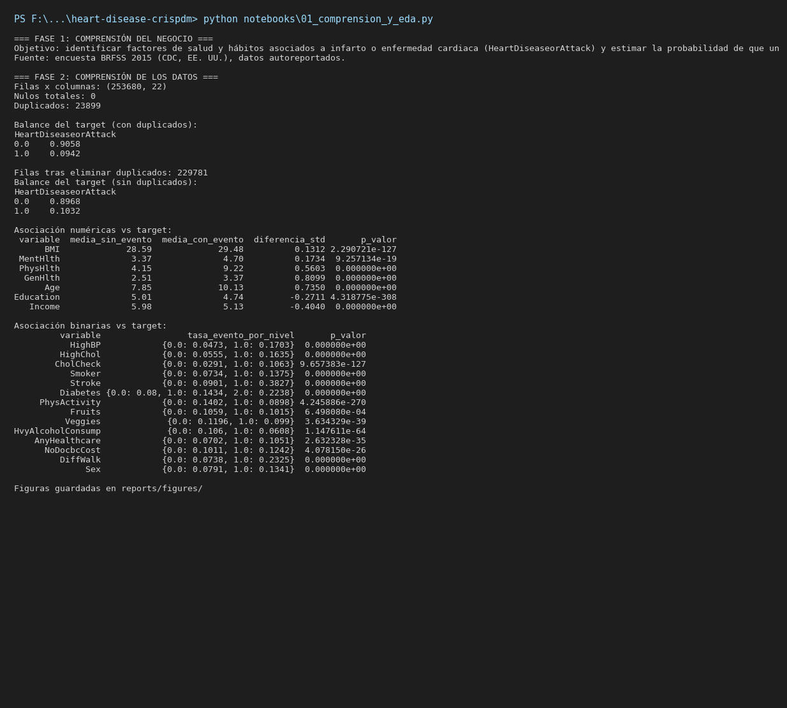

### 2.4 Análisis exploratorio

**Asociación de numéricas con el target** (Mann-Whitney U, `reports/asociacion_numericas_con_riesgo.csv`):

| Variable | Media sin evento | Media con evento | Diferencia (en desv. estándar) | p-valor |
|---|---|---|---|---|
| Age | 7,85 | 10,13 | 0,735 | < 0,001 |
| GenHlth | 2,51 | 3,37 | 0,810 | < 0,001 |
| Income | 5,98 | 5,13 | −0,404 | < 0,001 |
| PhysHlth | 4,15 | 9,22 | 0,560 | < 0,001 |
| Education | 5,01 | 4,74 | −0,271 | < 0,001 |
| BMI | 28,59 | 29,48 | 0,131 | < 0,001 |

**Asociación de binarias con el target** (chi-cuadrado, `reports/asociacion_binarias_con_riesgo.csv`): todas significativas salvo `Fruits` (p = 0,0006, efecto muy pequeño). Mayores tasas de evento: `Stroke` (38,3 % si sí, 9,0 % si no), `DiffWalk` (23,3 % vs 7,4 %), `HighBP` (17,0 % vs 4,7 %), `HighChol` (16,4 % vs 5,6 %), `Diabetes` nivel 2 (22,4 %).

**Correlación con el target** (`reports/correlacion_con_target.csv`): `GenHlth` (0,26), `Age` (0,22), `DiffWalk` (0,21), `HighBP` (0,21), `Stroke` (0,20).

**Tasa de evento por edad:** sube de 0,5 % en el grupo 1 a 24,6 % en el grupo 13.

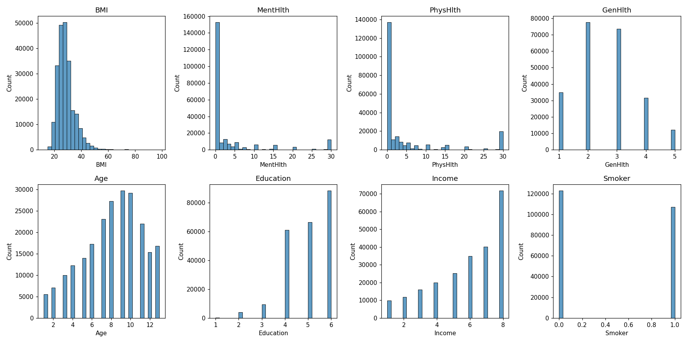

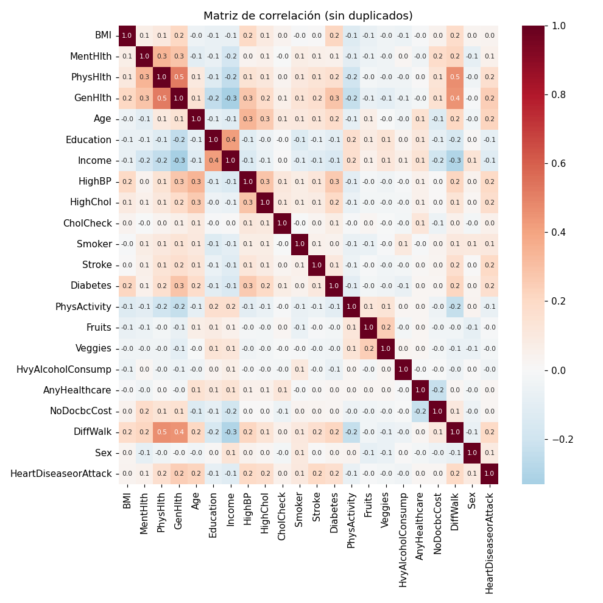

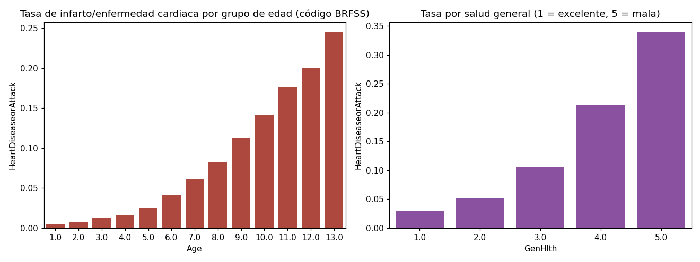

---

## 3. Preparación de los datos

Script: `notebooks/02_preparacion_y_base_de_datos.py` (notebook: `notebooks/02_preparacion_y_base_de_datos.ipynb`).

### 3.1 Validación de calidad

Cada columna se verificó contra su rango de códigos BRFSS:

| Variable | Rango válido |
|---|---|
| `BMI` | 12 – 98 |
| `MentHlth`, `PhysHlth` | 0 – 30 |
| `GenHlth` | 1 – 5 |
| `Age` | 1 – 13 |
| `Education` | 1 – 6 |
| `Income` | 1 – 8 |
| `Diabetes` | 0 – 2 |
| Binarias | solo 0 y 1 |

**Resultado:** 0 valores fuera de rango y 0 binarias con valores distintos de 0/1.

### 3.2 Limpieza

- **Eliminación de duplicados exactos:** 253.680 filas, quedaron **229.781** filas (se eliminaron 23.899).
- Se reindexó el DataFrame resultante.

Decisión: se eliminan los duplicados exactos porque cada respuesta debería ser una persona distinta. Dos personas con exactamente el mismo perfil pueden existir, y esto se documenta como limitación.

### 3.3 Variables derivadas

| Variable nueva | Cálculo | Propósito |
|---|---|---|
| `edad_aprox` | código `Age` mapeado a un punto medio del grupo (21, 27, …, 82 años) | edad en años para reportes |
| `categoria_imc` | `BMI` cortado en bajo peso < 18,5; normal < 25; sobrepeso < 30; obesidad ≥ 30 | interpretación clínica |
| `num_condiciones` | suma de `HighBP`, `HighChol`, `Diabetes`, `Smoker` y `Stroke` (mayor que 0) | carga de factores de riesgo |
| `inactivo` | `1 − PhysActivity` | sedentarismo |
| `sexo` | `Sex` mapeado a "Mujer"/"Hombre" | legibilidad |

Las derivadas se guardaron en la base de datos para consulta y reporte. **No se usaron como predictores**, porque repiten información de columnas que ya están (`Age`, `BMI`, `Sex`) y así se evita multicolinealidad.

### 3.4 Codificación de variables categóricas

No hubo codificación one-hot. Todas las categóricas del dataset ya vienen codificadas como enteros en la fuente BRFSS:

- Binarias (`Sex`, `HighBP`, etc.) quedan con 0/1.
- Ordinales (`Age`, `GenHlth`, `Education`, `Income`, `Diabetes`) se conservan como enteros. Es una decisión deliberada: su orden tiene sentido (más edad, más riesgo) y el modelo puede aprovecharlo. Con one-hot se perdería esa información y se aumentaría la dimensión sin ganancia clara.

Contraste con `health-lifestyle-crispdm`: allí sí se usó one-hot para `gender` y las categorías derivadas, porque eran texto sin orden.

### 3.5 Normalización (escalado)

- **Regresión logística y línea base:** `StandardScaler` dentro de un `Pipeline` (media 0, desviación 1). La regresión penaliza por igual todas las variables, y `Age` (1–13) y `MentHlth` (0–30) están en escalas distintas. El escalado también hace comparables los coeficientes.
- **Random Forest y gradient boosting:** sin escalado. Los árboles dividen por umbrales y no dependen de la escala.

El escalador se ajusta **solo con el conjunto de entrenamiento** (dentro del pipeline) y se aplica después a prueba. Así no hay fuga de información del conjunto de prueba.

### 3.6 Carga en base de datos SQLite

Archivo: `data/heart_disease.db`

| Tabla | Filas | Contenido |
|---|---|---|
| `raw_encuesta` | 253.680 | datos originales sin modificar |
| `encuestados` | 229.781 | datos limpios, sin duplicados y con derivadas |

Índices: `idx_enc_target` (sobre `HeartDiseaseorAttack`) e `idx_enc_edad` (sobre `Age`).

Verificación de la carga (tasa de evento por grupo de edad):

| Grupo de edad (`Age`) | Tasa de evento | Registros |
|---|---|---|
| 1 | 0,53 % | 5.512 |
| 5 | 2,50 % | 14.050 |
| 9 | 11,25 % | 29.736 |
| 13 | 24,55 % | 16.813 |

Salida real de la fase 3:

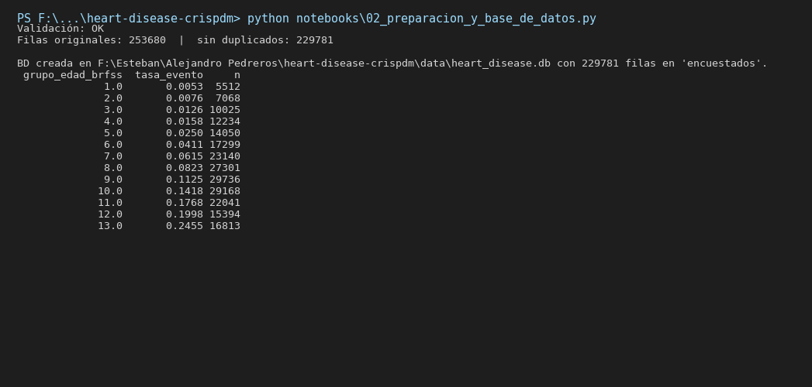

---

## 4. Modelamiento

Script: `notebooks/03_modelamiento_y_evaluacion.py`. El notebook `03_modelamiento_y_evaluacion.ipynb` está guardado con el código y sin ejecutar: esta fase tarda unos 30 minutos por SHAP, así que su salida real es la del log de ejecución en `reports/logs/03_modelamiento_y_evaluacion.log`.

### 4.1 Partición

- Estratificada por el target para que la prevalencia sea igual en entrenamiento y prueba.
- Entrenamiento: **183.824** filas (80 %). Prueba: **45.957** filas (20 %). Prevalencia en prueba: **10,32 %**.

### 4.2 Predictores (21)

`HighBP`, `HighChol`, `CholCheck`, `BMI`, `Smoker`, `Stroke`, `Diabetes`, `PhysActivity`, `Fruits`, `Veggies`, `HvyAlcoholConsump`, `AnyHealthcare`, `NoDocbcCost`, `GenHlth`, `MentHlth`, `PhysHlth`, `DiffWalk`, `Sex`, `Age`, `Education`, `Income`.

### 4.3 Modelos

| Modelo | Configuración |
|---|---|
| Línea base | predice siempre la clase mayoritaria (referencia) |
| Regresión logística | `StandardScaler` + `LogisticRegression(max_iter=1000, class_weight="balanced")` |
| Random Forest | 300 árboles, profundidad máxima 12, `min_samples_leaf=50`, `class_weight="balanced_subsample"` |
| Gradient boosting | `HistGradientBoostingClassifier(class_weight="balanced")` |

Random Forest y regresión logística son las dos familias que usa el repositorio de referencia. El gradient boosting se incluyó como comparación adicional.

**Manejo del desbalance:** `class_weight` pondera la clase positiva (10 %) en la función de pérdida, en lugar de remuestrear los datos, y así no altera la distribución real.

**No se hizo búsqueda de hiperparámetros.** Es una limitación documentada.

### 4.4 Validación cruzada

`StratifiedKFold` con 5 folds sobre el conjunto de entrenamiento. El conjunto de prueba no se usó para elegir modelos.

### 4.5 Curvas de aprendizaje

Se calcularon para regresión logística y Random Forest, con PR-AUC y 5 tamaños de entrenamiento.

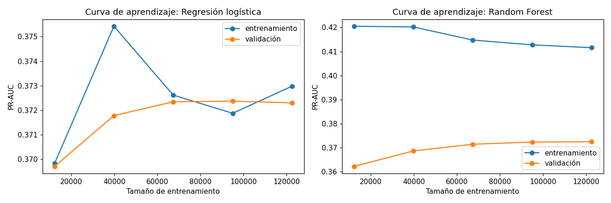

- **Regresión logística:** las curvas de entrenamiento y validación convergen en ~0,372–0,373. Sin brecha, con poca variación entre tamaños.
- **Random Forest:** brecha de ~0,04 PR-AUC entre entrenamiento (~0,41) y validación (~0,372). Hay sobreajuste leve. La validación se estabiliza cerca de 0,372 desde ~95.000 registros, así que más datos aportarían poco.

Salida real del modelamiento (fase 4 y 5):

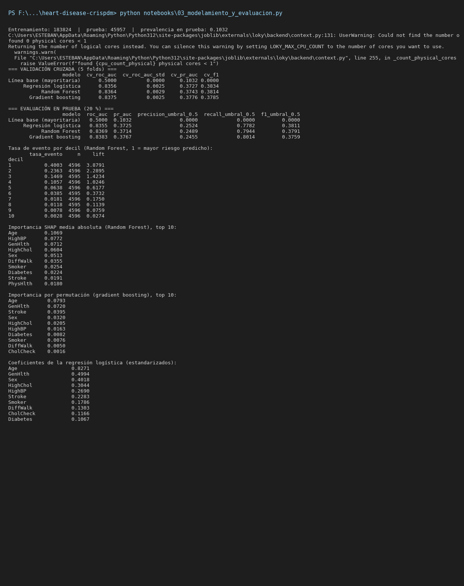

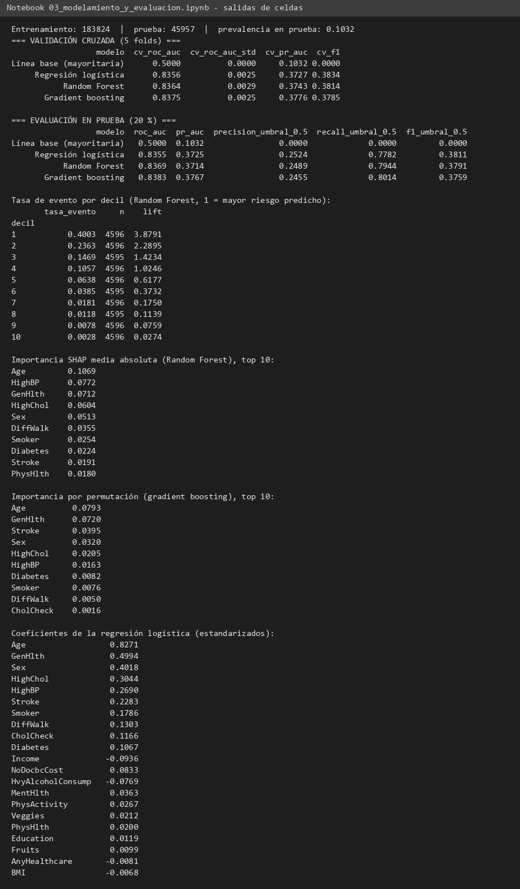

---

## 5. Evaluación

### 5.1 Métricas usadas y por qué

Con 10 % de positivos, la **accuracy** engaña: el modelo que siempre dice "no" tiene 89,7 % de accuracy y no sirve. Por eso se usan:

- **ROC-AUC:** qué tan bien separa los dos grupos, independiente del umbral.
- **PR-AUC (average precision):** calidad en la clase positiva. Su línea base es la prevalencia (0,103).
- **Precisión, recall y F1** con umbral 0,5.

### 5.2 Validación cruzada (entrenamiento, 5 folds)

| Modelo | ROC-AUC | Desv. est. | PR-AUC | F1 |
|---|---|---|---|---|
| Línea base | 0,500 | 0,000 | 0,103 | 0,000 |
| Regresión logística | 0,836 | 0,003 | 0,373 | 0,383 |
| Random Forest | 0,836 | 0,003 | 0,374 | 0,381 |
| Gradient boosting | 0,838 | 0,003 | 0,378 | 0,379 |

### 5.3 Prueba (20 %, no vista durante el entrenamiento)

| Modelo | ROC-AUC | PR-AUC | Precisión (0,5) | Recall (0,5) | F1 (0,5) |
|---|---|---|---|---|---|
| Línea base | 0,500 | 0,103 | 0,000 | 0,000 | 0,000 |
| Regresión logística | 0,836 | **0,373** | **0,252** | 0,778 | **0,381** |
| Random Forest | 0,837 | 0,371 | 0,249 | 0,794 | 0,379 |
| Gradient boosting | **0,838** | **0,377** | 0,246 | **0,801** | 0,376 |

Las métricas de validación cruzada y prueba coinciden dentro de ~0,003, así que no hay sobreajuste relevante en la evaluación. Los tres modelos quedan a menos de 0,003 de ROC-AUC entre sí.

### 5.4 Curvas y matriz de confusión

- Curvas ROC: `reports/figures/04_curvas_roc.png`.
- Matriz de confusión del mejor modelo por ROC-AUC (gradient boosting, umbral 0,5): `reports/figures/05_matriz_confusion.png`.

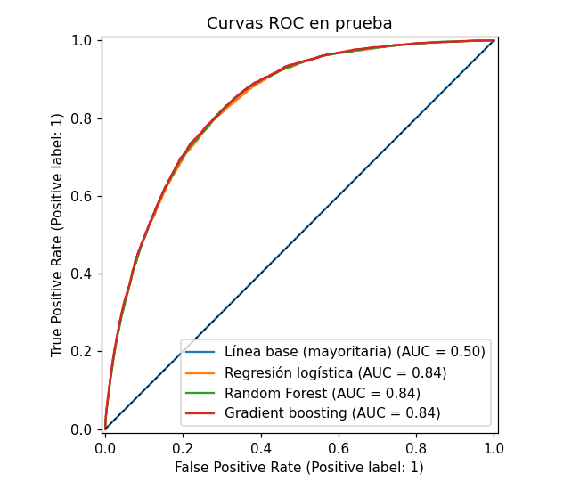

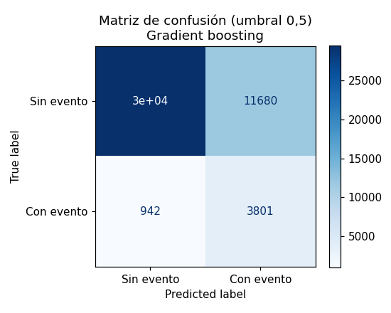

### 5.5 Ganancia por deciles (Random Forest)

Se ordenaron los registros de prueba por probabilidad predicha y se midió la tasa real de evento por decil. Tasa media: 10,3 %.

| Decil (1 = mayor riesgo) | Tasa real de evento | Lift |
|---|---|---|
| 1 | 40,0 % | 3,88 |
| 2 | 23,6 % | 2,29 |
| 3 | 14,7 % | 1,42 |
| 4 | 10,6 % | 1,02 |
| 5 | 6,4 % | 0,62 |
| 6 | 3,9 % | 0,37 |
| 7 | 1,8 % | 0,18 |
| 8 | 1,2 % | 0,11 |
| 9 | 0,8 % | 0,08 |
| 10 | 0,3 % | 0,03 |

El primer decil concentra 40 % de eventos reales, casi 4 veces la tasa media. Para una campaña de prevención, contactar primero a ese decil es la estrategia más eficiente.

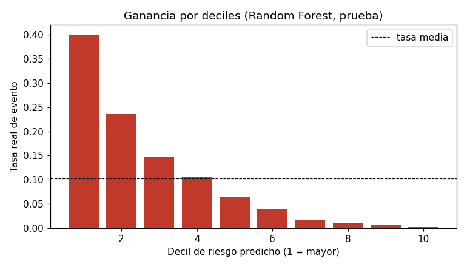

### 5.6 Variables más influyentes

**SHAP sobre Random Forest** (media absoluta de valores SHAP, muestra de 300 registros de prueba, `reports/importancia_shap_random_forest.csv`):

| Posición | Variable | SHAP medio |
|---|---|---|
| 1 | Age | 0,107 |
| 2 | HighBP | 0,077 |
| 3 | GenHlth | 0,071 |
| 4 | HighChol | 0,060 |
| 5 | Sex | 0,051 |
| 6 | DiffWalk | 0,036 |
| 7 | Smoker | 0,025 |
| 8 | Diabetes | 0,022 |
| 9 | Stroke | 0,019 |
| 10 | PhysHlth | 0,018 |

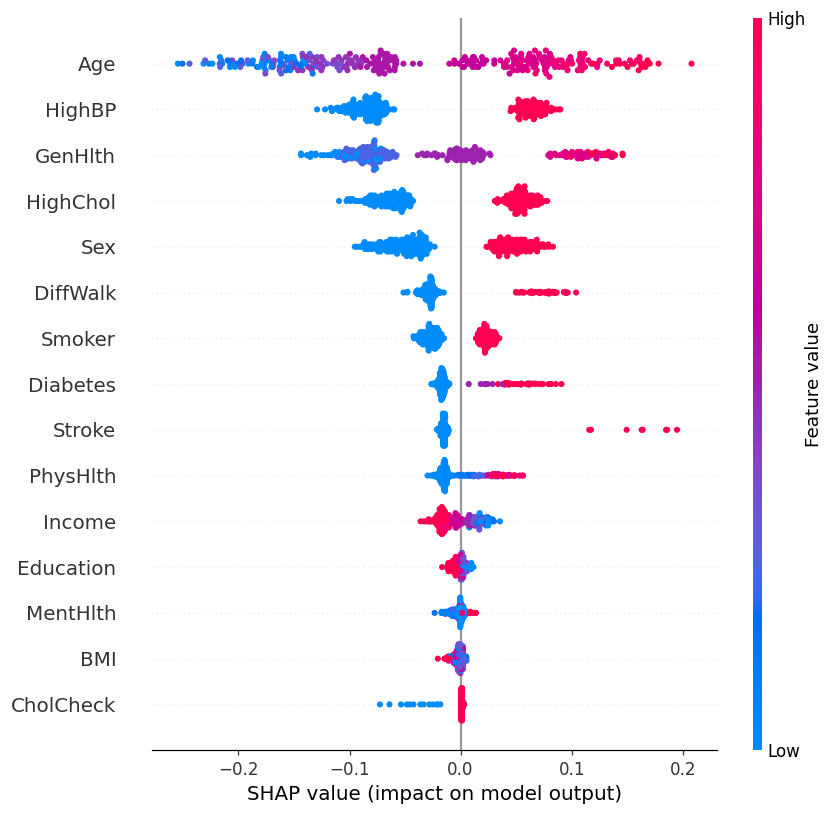

**Coeficientes de la regresión logística** (predictores estandarizados): `Age` (0,83), `GenHlth` (0,50), `Sex` (0,40), `HighChol` (0,30), `HighBP` (0,27), `Stroke` (0,23). Coeficientes negativos más fuertes: `Income` (−0,09) y `HvyAlcoholConsump` (−0,08).

**Importancia por permutación del gradient boosting** (`reports/importancia_permutacion_gb.csv`): `Age` (0,079), `GenHlth` (0,072), `Stroke` (0,040), `Sex` (0,032), `HighChol` (0,021).

**Lectura:** edad, salud general, presión alta, colesterol alto y sexo aparecen en el top de los tres métodos. `Stroke` tiene más peso en la permutación del gradient boosting, pero menos en SHAP del Random Forest; no se afirma un orden exacto.

### 5.7 Lectura práctica

Con umbral 0,5, el modelo detecta cerca del 78–80 % de los casos reales, pero solo uno de cada cuatro positivos predichos es verdadero. Para tamizaje esto puede ser aceptable. Si el costo de una falsa alarma es alto, conviene subir el umbral.

---

## 5.7. Robustez, equidad y calibración

Estos resultados vienen de `notebooks/06_robustez_y_equidad.py`, que reajusta los dos modelos principales con la misma partición de la fase 3.

**Intervalos de confianza (bootstrap, 1.000 remuestreos del conjunto de prueba, IC 95 %):**

| Modelo | ROC-AUC | IC 95 % | PR-AUC | IC 95 % |
|---|---|---|---|---|
| Regresión logística | 0,8355 | 0,8300 a 0,8407 | 0,3725 | 0,3597 a 0,3873 |
| Random Forest | 0,8369 | 0,8314 a 0,8420 | 0,3714 | 0,3575 a 0,3857 |

Los intervalos son estrechos y se traslapan. La diferencia entre regresión logística y Random Forest no es estadísticamente distinguible.

**Equidad por subgrupo (umbral 0,5):**

| Grupo | Modelo | n | ROC-AUC | Recall | Precisión |
|---|---|---|---|---|---|
| Hombres | Regresión logística | 20.239 | 0,822 | 0,832 | 0,268 |
| Mujeres | Regresión logística | 25.718 | 0,837 | 0,707 | 0,231 |
| 65 años o más | Regresión logística | 16.620 | 0,755 | 0,872 | 0,265 |
| Menores de 65 | Regresión logística | 29.337 | 0,848 | 0,608 | 0,225 |
| Hombres | Random Forest | 20.239 | 0,824 | 0,842 | 0,270 |
| Mujeres | Random Forest | 25.718 | 0,838 | 0,731 | 0,223 |
| 65 años o más | Random Forest | 16.620 | 0,757 | 0,881 | 0,264 |
| Menores de 65 | Random Forest | 29.337 | 0,850 | 0,638 | 0,218 |

Con el mismo umbral, el modelo detecta más casos en mujeres y en mayores de 65 años que en los demás grupos, pero con menor precisión. El ROC-AUC es menor en mayores de 65 (cerca de 0,76), lo que indica que distinguir quién tendrá el evento dentro de ese grupo es más difícil.

**Calibración:**

| Modelo | Brier | Probabilidad media predicha | Prevalencia observada |
|---|---|---|---|
| Regresión logística | 0,1709 | 0,364 | 0,103 |
| Random Forest | 0,1654 | 0,362 | 0,103 |

Las probabilidades no están calibradas. Su promedio es casi cuatro veces la prevalencia real, efecto de `class_weight="balanced"`, que sube el peso de los casos positivos. Por eso las probabilidades sirven para **ordenar** a las personas por riesgo relativo, pero no deben leerse como probabilidad absoluta de infarto. Para usarlas como riesgo real habría que recalibrarlas (por ejemplo, con regresión isotónica o de Platt) y volver a evaluar.

Figura de calibración: `reports/figures/09_calibracion.png`.

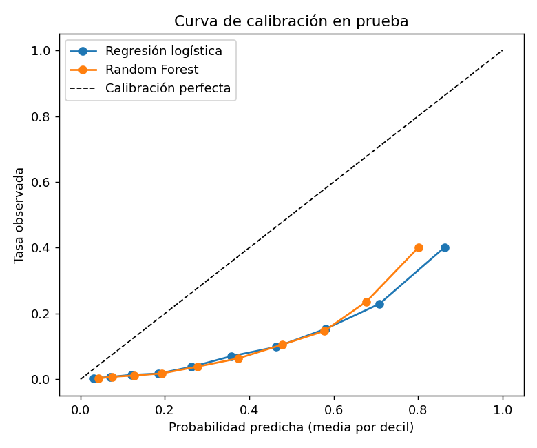

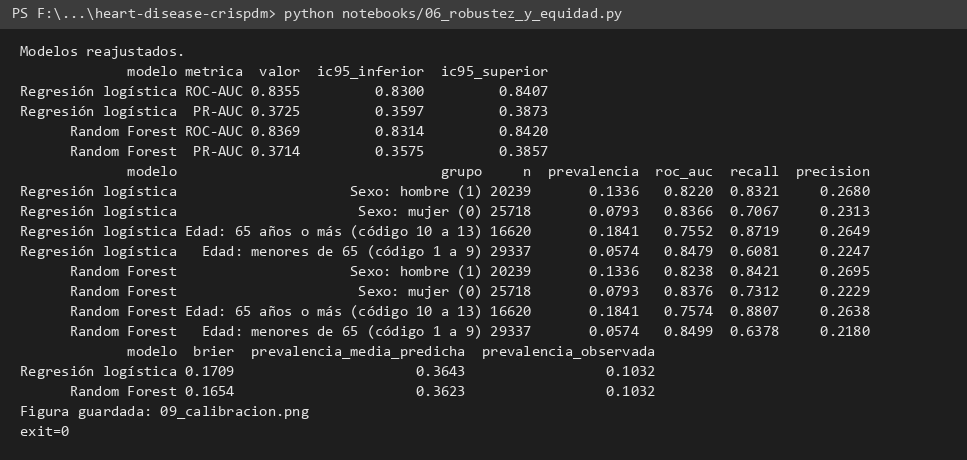

## 6. Presentación de resultados

Entregables:

- **Presentación ejecutiva en PDF:** `reports/presentacion_resultados.pdf` (12 páginas, horizontal).
- Informe técnico: `reports/informe_tecnico.md` (este archivo).
- Informe ejecutivo en Markdown: `reports/resultados_crispdm.md`.
- Tablas: `reports/metricas_*.csv`, `reports/asociacion_*.csv`, `reports/ganancia_por_decil_random_forest.csv`, `reports/importancia_shap_random_forest.csv`, `reports/coeficientes_regresion_logistica.csv`, `reports/importancia_permutacion_gb.csv`.
- Figuras: `reports/figures/` (01 a 08).
- Notebooks: `notebooks/01_comprension_y_eda.ipynb` y `notebooks/02_preparacion_y_base_de_datos.ipynb` (ejecutados), `notebooks/03_modelamiento_y_evaluacion.ipynb` (sin ejecutar; salida en logs).
- Logs de ejecución: `reports/logs/`.
- Pantallazos: `reports/screenshots/`.
- Base de datos: `data/heart_disease.db`.

**Recomendación:** la regresión logística es la opción para producción si se necesita explicar cada coeficiente. El gradient boosting obtiene la mayor ROC-AUC y PR-AUC en prueba, pero la diferencia con la regresión logística es de 0,003 en ROC-AUC y 0,004 en PR-AUC. Esa diferencia no justifica perder interpretabilidad.

---

## 7. Limitaciones y trabajo futuro

1. Datos autoreportados y de corte transversal: no se puede inferir causalidad.
2. Eliminación de duplicados exactos: puede descartar respuestas válidas de personas distintas con el mismo perfil.
3. Sin búsqueda de hiperparámetros ni calibración de probabilidades.
4. SHAP se calculó sobre 300 registros. Una primera ejecución con 2.000 registros superó el límite de 900 s, así que se redujo la muestra. Los valores son estimaciones de esa muestra.
5. La presentación PDF se verificó por número de páginas y texto. No se pudo renderizar a imagen en este equipo porque falta poppler.
6. Sin validación externa en otra población ni en otro año de BRFSS.
7. Las probabilidades no están calibradas (promedio cerca de 0,36 frente a una prevalencia de 0,10). Sirven para ordenar riesgo, no como probabilidad absoluta.
8. Los IC bootstrap cubren solo la variabilidad del conjunto de prueba, no la de la partición ni la de la población.

---

## Consideraciones éticas

- **Datos de salud:** el dataset proviene de una encuesta de los CDC, sin nombres ni identificadores directos. Los resultados se presentan siempre en agregado y no deben usarse para identificar personas.
- **Uso del modelo:** las predicciones sirven para orientar la prevención y la conversación clínica. No reemplazan el diagnóstico médico ni deben usarse para decidir seguros, empleo o acceso a servicios.
- **Sesgo y equidad:** la encuesta es telefónica y autoreportada, por lo que puede no representar bien a todos los grupos. El desempeño por sexo y edad se revisó (sección 5.6), y muestra diferencias de recall y precisión. Hay que revisar esas brechas antes de cualquier uso real.
- **Falsos negativos:** un modelo con precisión baja y recall alto genera muchas alertas falsas. Esa carga debe considerarse frente a los costos de pasar por alto un caso.
- **Licencia:** el dataset se publica bajo CC0 (dominio público), por lo que su uso es libre con la atribución de la fuente.

---

## Anexo A. Pasos ejecutados en orden

| # | Paso | Script / herramienta | Salida |
|---|---|---|---|
| 1 | Descargar dataset desde la API pública de Kaggle | `curl` | CSV de 22,7 MB |
| 2 | Crear estructura de carpetas | Bash | `data/`, `notebooks/`, `reports/` |
| 3 | Perfilar datos (nulos, duplicados, rangos, correlaciones) | Python | consola |
| 4 | Fase 1–2: EDA, pruebas estadísticas, figuras | `01_comprension_y_eda.py` | `reports/*.csv`, `figures/01–03` |
| 5 | Fase 3: validación, limpieza, derivadas, SQLite | `02_preparacion_y_base_de_datos.py` | `data/heart_disease.db` |
| 6 | Fase 4–5: CV, prueba, curvas de aprendizaje, SHAP, deciles, permutación | `03_modelamiento_y_evaluacion.py` | `reports/metricas_*.csv`, `figures/04–08` |
| 7 | Primera ejecución de SHAP con 2.000 registros: superó 900 s (código 124) | `03_…py` | sin figura 08 |
| 8 | Reducir la muestra SHAP a 300 y re-ejecutar la fase completa | `03_…py` | log completo, `figures/08` |
| 9 | Registrar salidas de cada paso | `> reports/logs/*.log` | `reports/logs/` |
| 10 | Pantallazos del terminal renderizados a partir de los logs | Python + matplotlib | `reports/screenshots/terminal_*.png` |
| 11 | Captura de la página del dataset en Kaggle | navegador de prueba | `reports/screenshots/06_kaggle_pagina_dataset.png` |
| 12 | Convertir fases a notebooks `.ipynb` (1, 2 y 3 ejecutados) | `_convertir_a_ipynb.py` | `notebooks/*.ipynb` |
| 13 | Generar la presentación ejecutiva en PDF | `04_presentacion_pdf.py` | `reports/presentacion_resultados.pdf` |
| 14 | Redactar el informe técnico | Markdown | este archivo |
| 15 | Robustez y equidad: IC bootstrap, métricas por subgrupo, calibración | `06_robustez_y_equidad.py` | `reports/intervalos_confianza_bootstrap.csv`, `metricas_por_subgrupo.csv`, `calibracion_brier.csv`, `figures/09` |
| 16 | Registrar salida de la fase 6 y pantallazo | `> reports/logs/06_*.log` | `reports/screenshots/terminal_06_*.png` |
| 17 | Ejecutar el notebook de la fase 3 para guardar sus salidas | `nbclient` | `notebooks/03_modelamiento_y_evaluacion.ipynb` |
| 18 | Incluir la fase 6 (robustez, equidad, calibración) en el PDF de 15 páginas | `04_presentacion_pdf.py` | `reports/presentacion_resultados.pdf` |
| 19 | Generar diapositivas en PowerPoint | `07_diapositivas_pptx.py` | `reports/presentacion_resultados.pptx` |

**Sobre la captura del escritorio:** se tomó una captura completa del escritorio, pero se descartó porque mostraba conversaciones y datos ajenos al proyecto. No se incluye.
